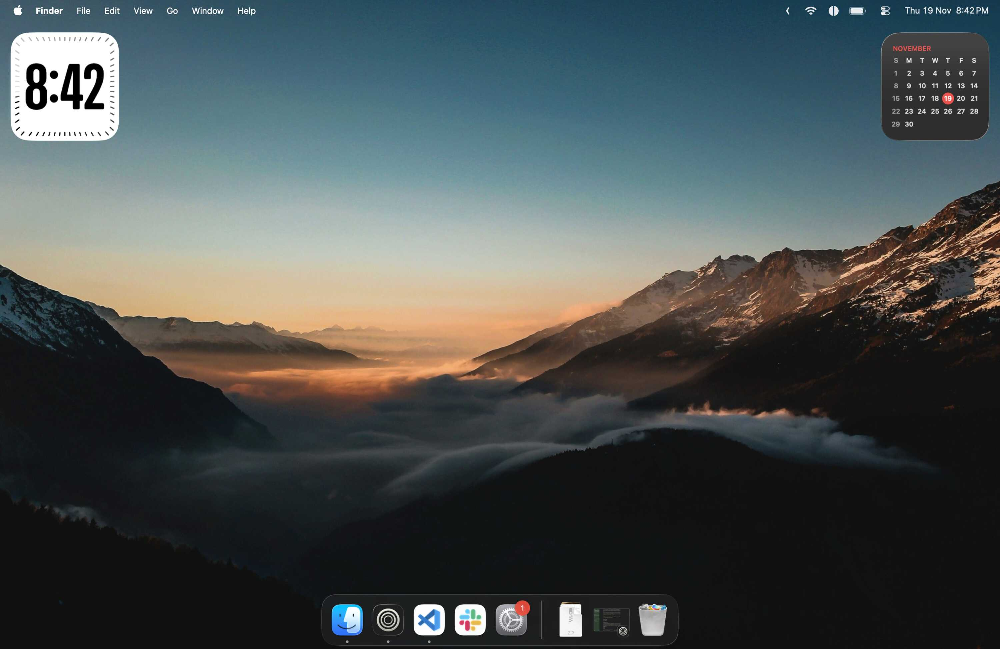
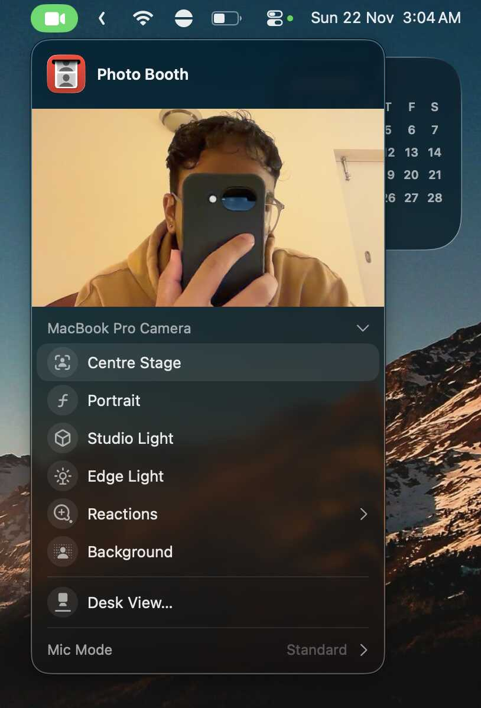
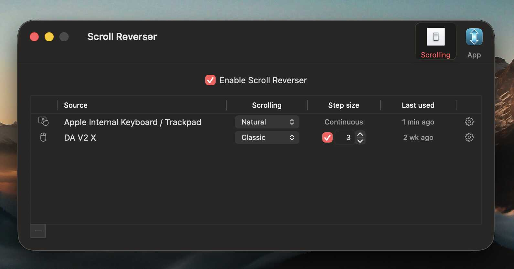
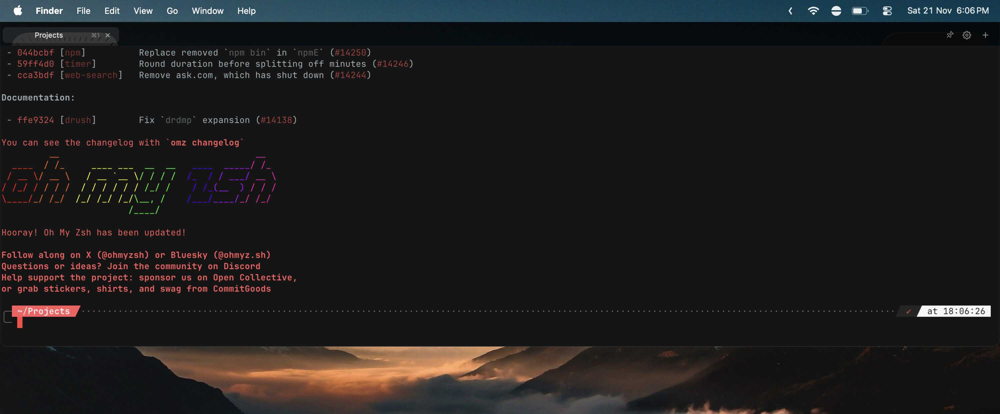
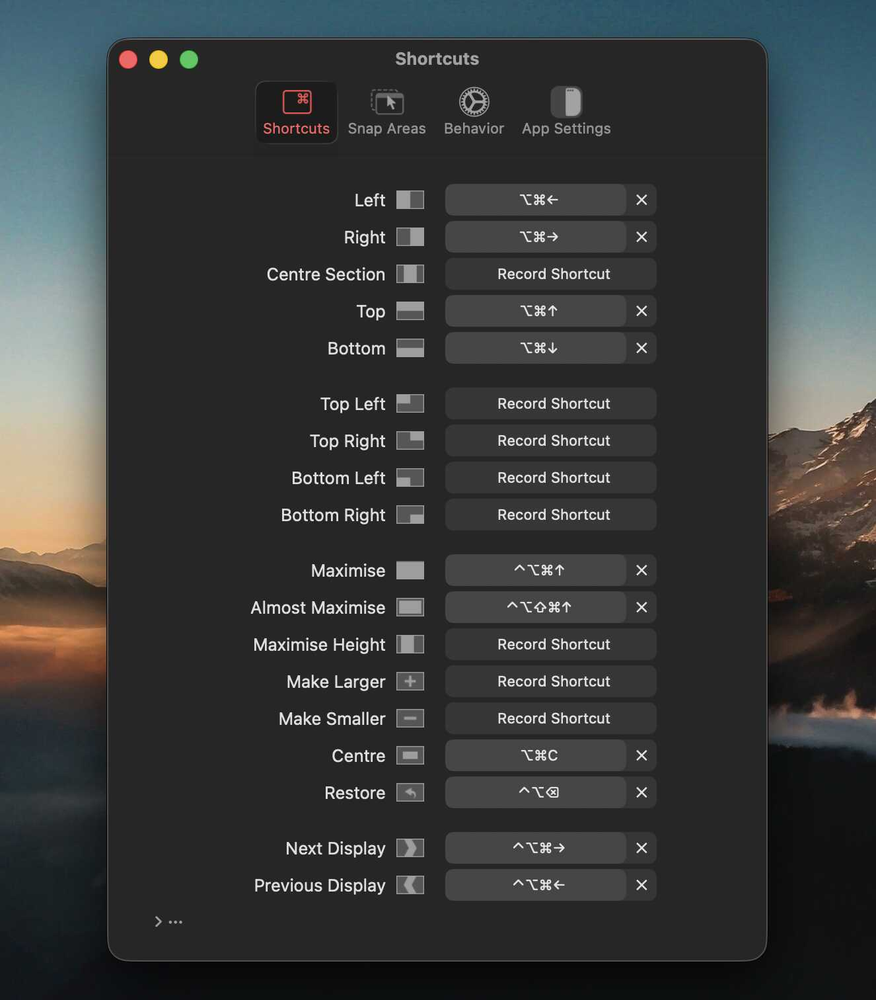
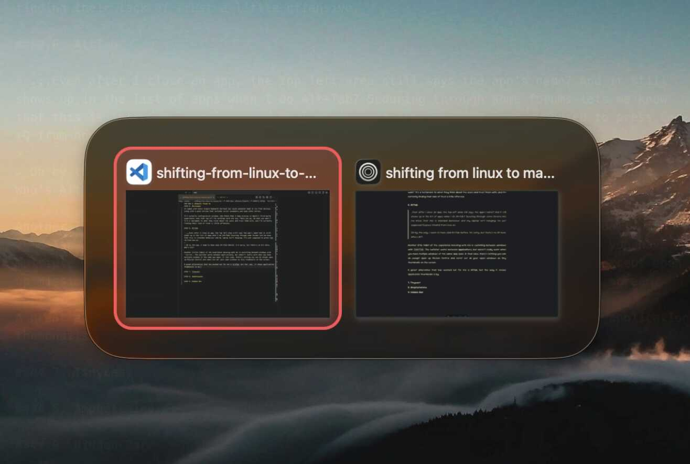
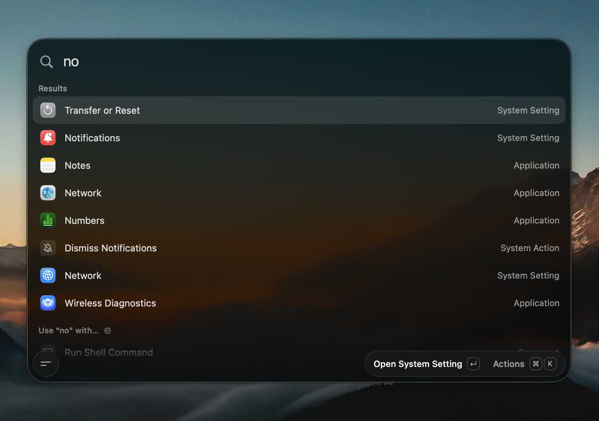
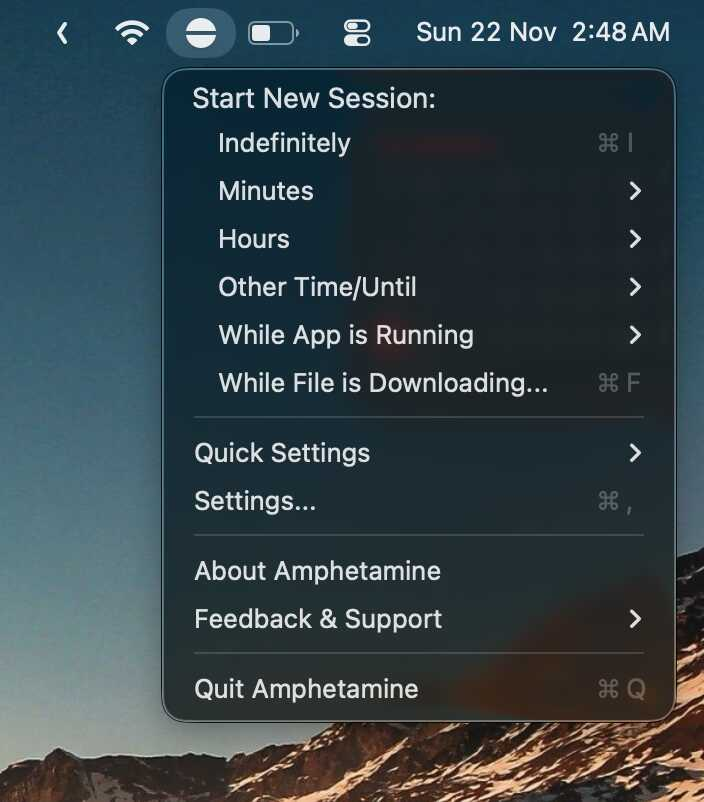
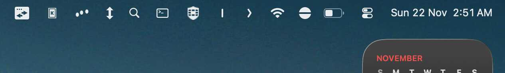

This post was first a rant. A long one, going on about how limited macOS is and how "stupid" every single design choice is. It was a Linux tinkerer crashing out because he was used to the freedom of doing and customizing anything and everything on his system, to the point of sometimes corrupting his OS and having to re-install it from scratch.

I'm still that tinkering kid and I'm still quite annoyed, but I think I've found enough things to like about the MacBook (plus enough third-party apps that make the experience comfortable) that I'm fine, for now. So this is me documenting what made macOS comfortable for me, and create a new but familiar home.

This post is dedicated to Accessibility Services, which -- apart from heroically opening up software use to people with disabilities -- make even the most locked down systems somewhat customizable for the general public.

> Also, from time to time, I'll attach parts of my original rant like so.

### What I ~Love~ Like

#### 1. Hardware Shenanigans

You could say the hardware isn't related to the operating system, but macOS is something that you can only experience properly on a MacBook. And the sleekness of the machine, the sharpness/color accuracy of the display, and precise/tactile nature of the components definitely makes it all come together.

They really don't mess around when they're talking about Retina or ProMotion or whatever the latest one is called, because the colours of the display _feel_ right. And the speakers -- though they're not something I'll use often on a work laptop -- create a sound stage that I've not experienced from laptops. Fitting all this into something this thin is a marvel of engineering.

#### 2. Touchpad & Gestures

This part, just by itself, has ruined my software experience on anything that's not a MacBook.

The touchpad is _so_ intuitive, and _so_ easy to click. I love how I can configure the "heaviness" of the click to be as much or as little as I want. I'm someone that usually opens the right-click menu (or closes tabs) by tapping with two/three fingers, but I enjoy the haptic feedback so much that I now click anyway.

The gestures are so simple too, by the way. I was never one to use workspaces or "Virtual Desktops" on my machine before, but you could say the operating system has forced me to think in workspaces -- and move maximized windows into a different space, to emphasize that they are a "big screen activity".

I love the surety of the multi-finger swipes. The physics of the windows/spaces moving around in response to my fingers is so well-made. I only learned recently (while trying to replicate this on KDE) that this _does_ exist on my Linux machine, but the animations are much, much jankier. I watch KDE complete the action and I hear, "Waait, are you really sure you want this space to move away?"

The scrolling experience also feels much smoother than it used to on Windows, back when I used it three years ago. I really like reading/viewing other people's websites on the MacBook now. God, I have been spoiled.

#### 3. Battery & Performance

There's this satisfaction I get when I open my laptop after a long time, and notice that the battery has not gone down as much as I'd anticipated.

I already experienced this once when I shifted from Windows to Linux; because Linux does extremely well in saving energy. I really don't know what Windows is doing though, maybe trying to spin the fans so fast that the laptop flies to Microsoft Headquarters and they can harvest your data.

Anyway, the MacBook's battery life does not disappoint. I've not experienced a single lag spike on the machine yet (touchwood) and don't have to think about charging the laptop throughout my working day. I just keep the laptop plugged in when I'm at my desk and forget about it otherwise.

#### 4. One-Click Dictionary

I was just messing around with the touchpad haptics, when I learned that I can "deep click" a word _anywhere_ to look it up in the dictionary. I then learned that I can select a longer phrase and do the same thing to look up the whole phrase. It's instant too!

This is great because I oftentimes skip trying to understand a word while reading, just because looking it up and coming back would lose me a lot of context. But having it a click away makes me more likely to stop and learn. This does make the experience of reading blogposts better too.

#### 5. Webcam Configuration

The webcam on the MacBook, from what I understand, is an ultrawide feed which they crop into. This means that the webcam _is_ recording more of an area than it is showing you, and you can move the view around (in the Menu Bar settings) to position yourself in the feed as you like.

This has helped me because I no longer have to center myself in the camera and instead just move the feed itself. There's also Center Stage (which follows you around as you move), but I'd rather not turn it on because it can be distracting for other people during a meeting.

Overall I'm just really happy with all the things I can tweak about the webcam feed system-wide, even if all I'll really use it for is meetings.

> You might have noticed that most of these details relate more to the hardware, and less the software. Yeah… 

### What I Dislike

#### 1. App Management

> Alright so, the top left of each window has three buttons, right? Forget that they are on the left instead of the right like every other operating system. Now, when I click on the red icon with an "X" on it, what would you expect to happen? The app would close, yes? THEN WHY DOES THE APPLICATION STILL STAY OPEN?

When I brought this up with a long-time Mac user, they told me that this "app suspension" is what makes the macOS feel faster. But to me this entire system feels like an organizational nightmare. Every app that you "close" this way still remains on the dock with a dot underneath it, making me feel like it's still open.

And now that they can't use that dot to denote a minimized window, they show minimized apps as an actual snapshot _next to the Trash Bin_. The app's icon becomes even smaller next to the snapshot, making it hard to tell which app the window is from. Instead of remembering the icon of the app, I now have to remember what my minimized window _looked like_. Ugh.

Thankfully, `Cmd+Q` and `Cmd+W` have become my closest friends here. They carry over pretty well to Linux as well, except I have to use `Ctrl` instead of `Cmd`. Oh, that reminds me--

#### 2. Mac's Modifier Keys

On a typical laptop, the layout for the four buttons next to the Spacebar is `Ctrl`, `Fn (Function)`, `Meta/Super (Windows)` and `Alt`. But on the Mac, it's `fn (Function)`, `control`, `option` and `command`.

> What in the mother of tarnation convinced these people that their buttons need to be _different_? The hell is the difference between Option, Command and Control? Also, there isn't a Delete key and they just call the Backspace key "Delete"? How do I delete text on the right side of my cursor? Some messing around shows me that it's now Fn+"Delete", that's good.
>
> I'd seen tutorials and help articles that mentioned the Command key separately for Mac users when talking about shortcuts. But the placement of this key is _so_ munted. Every piece of muscle memory that has pressed Ctrl for all these actions now has to press "Alt" in my head.
>
> I thought I would just fix this by making the Control key act as the Command key, but guess what? Some apps have taken it upon themselves as their sole responsibility to use Control for their shortcuts instead of Command. Which means I have to keep both keys around. There is no escape.
>
> Oh nevermind, there's still an Escape key. Thank God.

The obliteration of my muscle memory is still a valid problem, but what I'm finding more difficult to grasp is the "buckets" Apple has used to distinguish between the functions of the keys.

Usually, the `Super` key is used for shortcuts that are system-wide, `Ctrl` is for things inside the application that you're looking at, and `Alt` is for everything else inside the application to reach via shortcuts. There are definitely exceptions where `Alt+Tab` and `Super+Tab` do the same thing, but it's pretty straightforward overall.

In contrast, it's been a month since I got this machine and I _cannot_ figure out the "buckets". It doesn't help that third-party applications are as confused as I am, and use `Cmd` for some actions and `Control` for others. In general I have to depend a lot more on finding things visually, which is not a great experience.

#### 3. Window Positioning/Sizing

I said before that I've gotten comfortable with how windows maximize into full screen, but I still have a bit of a rant left in me. I don't know what Apple's problem was, that led to the default behaviour of opening applications _not_ be maximised windows. And even if they do, I don't see why there's a setting for them to just open maximised.

This is one of the first things I spot when looking at a Mac user's desktop -- having an app open and still seeing information from so many different apps open behind it. The old me would have cried, but the Mac me knows I'm now complicit in their moral crime.

Maximizing has become "Fill" and the maximize button makes windows full-screen. I have accepted that fate.

#### 4. Other Things

I don't want to make a lengthy rant about every single problem so I'm just going to quickfire through them.

- The Finder (File Explorer?) is more like a canvas, instead of a grid? Like, dragging an item to a new empty space leaves its previous position empty. And you can just move things around like that. It sounds like another organizational nightmare.
- The Spotlight Search, even though I've seen people rave about it, is actually quite slow in showing a list of options. I used to use KRunner on KDE, and that felt much faster than Spotlight.
- The renaming shortcut for files on a Mac is literally pressing `Enter`, which weirds me out because "Enter" is usually short for "execute" in my head.
- I can't toggle Natural Scrolling separately for my touchpad and for my mouse. The setting applies to all connected devices, and now my mouse/touchpad scroll in opposite directions.

It's all just a pile of inconveniences, and I don't want to treat it as any more than that. But thankfully, there are tiny little applets out there that can solve some of them for me. I'll list them out in-case they help out other people too.

### How I (Almost) Fixed It

#### 1. Scroll Reverser

It's hilarious to me that this is even a third-party utility, but I needed to fix the scrolling on my mouse and touchpad before I could continue setting up everything else. So this is just an applet that stays in the Menu Bar and lets you configure each device's settings separately.

The link to its website can be found [here](https://scrollreverser.com/).

#### 2. Macuake

I use [Yakuake](https://apps.kde.org/yakuake/) on Linux to have a persistent drop-down terminal that can appear on any screen. So if I have a quick command to run (or have SSH'ed into a server and want to leave the connection open) then I can always have it present.

I was missing that on macOS though, which is how I found [Macuake](https://github.com/menemy/macuake) a couple Reddit threads later. It has everything I needed from Yakuake, plus some clear tabs to allow opening multiple terminals. All of it is one `Option+Space` away.

#### 3. MiddleClick

I might have forgotten to mention, but I really liked how I could use a three-finger tap/click on Linux touchpads to close a tab (or open a link in a new one). KDE has a built-in option to make touchpads do this, but macOS is... built different.

So now I have [MiddleClick](https://github.com/artginzburg/MiddleClick) always open in the background. It's a small open-source utility which is good, and sips very little battery. They have very minimal settings too -- either to configure how many fingers make a middle-click, or to ignore certain applications from the service.

#### 4. Homebrew

With these utilities coming in from third parties (and macOS continuously making sure I knew the apps are downloaded from the Internet; like yes Apple, _all_ apps come from the Internet), I knew I couldn't depend on the App Store much longer. I also realized belatedly that the App Store wasn't showing me the install prompt anymore, because it considered Macuake as an "overlaying application".

So it wasn't long before I shifted my app management to be via [Homebrew](https://brew.sh/). I'm most likely not the first person introducing you to it, because it's a very well-accepted CLI installer on macOS. It is to macOS what "[pacman](https://wiki.archlinux.org/title/Pacman)" or "[yay](https://jguer.github.io/yay/)" are to Arch Linux, so it makes me feel comfy to use too.

#### 5. Rectangle

The Apple ecosystem seems to have a rich community of third-party window managers that are trying to fill the space and make up for the disappointment that macOS has brought. The [list of these window managers](https://macoswm.com/) is _loong_, but one that comes well-recommended to me from people is [Rectangle](https://rectangleapp.com/).

It comes with every single keyboard shortcut you could possibly need in its free version, along with a paid version that includes cursor movements and some other extras.

It's actually configuration windows like these that I keep missing in Apple's first-party experience; ones that lay all the settings bare and say, "Here you go, do what you want." It's a testament to what they think about the users and trust them with, and I'm currently finding their lack of trust a little offensive.

#### 6. AltTab

> ...Even after I close an app, the top left area still says the app's name? And it still shows up in the list of apps when I do Alt+Tab? Scouring through some forums lets me know that this is intended behaviour and my laptop isn't hanging; I'm just supposed to press Cmd+Q from now on.
>
> Oh by the way, I seem to have said Alt+Tab before. I'm sorry, but there's no Alt here. Who's Alt?

Another little tidbit of the experience messing with me is switching between windows with `Cmd+Tab`. The switcher works between applications, but doesn't really work when you have multiple windows of the same app open. In that case, there's nothing you can do except open up Mission Control and vomit out all your open windows as tiny thumbnails on the screen.

A great (and familiar) alternative that has worked out for me is [AltTab](https://alt-tab.app/), but the _way_ it shows app thumbnails is by using the _"screen recording" permission_ and recording snapshots of individual windows. It's a good thing that the app [is open-source](https://github.com/lwouis/alt-tab-macos), so you can go through and see how the source code uses that information. But the fact that someone other than Apple had to figure out this layout is really annoying.

#### 7. Tinycast

I already knew Spotlight Search wasn't fast enough for me, and I'd heard of [Raycast](https://www.raycast.com/) but knew it was closed-source. So I shifted directly to [Tinycast](https://tinycast.dev/), which is [an open-source alternative](https://github.com/abue-ammar/tinycast) to Raycast while being _completely_ instant and not leaving me missing any features from KRunner.

It lets me look through apps/files, remembers my clipboard history, lets me calculate things right in the search bar, and opens from the same shortcut that you normally use for Spotlight. Absolute legend. I also only know of this application because I saw someone from [IndieWebClub](https://blr.indiewebclub.org) write about it in their weeknotes. If I find that person, I'm going to edit this sentence!

#### 8. Amphetamine

KDE had this really easy button in its "Power & Battery" section, that let you suspend the device from sleeping until you disabled it again. I've used that toggle more recently (thanks to these darn LLM's) but also to allow myself the time to zone out while not worrying about my laptop going dark and the activity I was doing going away.

[Amphetamine](https://amphetamine-mac.app/) has really come in clutch to have that same functionality on the Mac, while still having a bunch of different controls that I'm never going to get into (because they'd be too complicated for me). Overall 10/10 recommend, but make sure you lock your laptops properly before leaving them and going away. :P

#### 9. Hidden Bar

Now, imagine that you have installed all these services and are using them on the daily. Since most of them stay alive by leaving an icon on your Menu Bar, you'll soon see the top-right corner of your screen looking like this.

Someone foresaw that too, and ended up creating something that might be one of the top items on this list.

Hidden Bar essentially creates two items in your tray; an arrow icon and a partition icon. Anything dragged to the left of the partition will be hidden when the arrow is toggled, while everything on the right will remain visible. It's a clever little piece that I'm glad to have, because it makes the desktop experience _much_ cleaner.

---

With that, the list is complete (for now). I've been using the final setup from this journey for a couple weeks now, and it's safe to say that I'm comfortable with this new environment. Maybe even prefer it over Linux. But I'll never admit that in public! And I'll never forgive them for taking `Ctrl` of my muscle memory!

I love the community of tinkerers that has come together in an attempt to make macOS their own, and I adore the creativity that every single app has portrayed. But it's still quite upsetting that Apple has created a rather hostile environment for this software, all in an attempt to dumb down the system for the average user.

If you find better alternatives to any of these problems, let me know. Maybe the solution we'll all come to is installing [Asahi](https://asahilinux.org/) on MacBooks. :D

The wallpaper used in these screenshots is an [aerial view of mountains](https://unsplash.com/photos/aerial-view-of-mountain-7OGWqEf5u88) taken by [Inés Álvarez Fdez](https://unsplash.com/@powwpic), and is free to use under [Unsplash](https://unsplash.com/).
