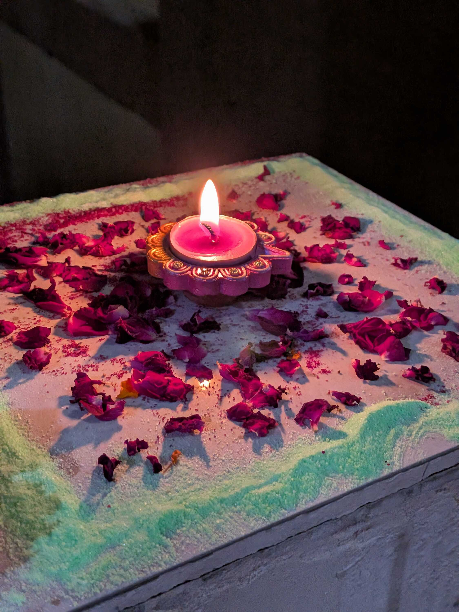
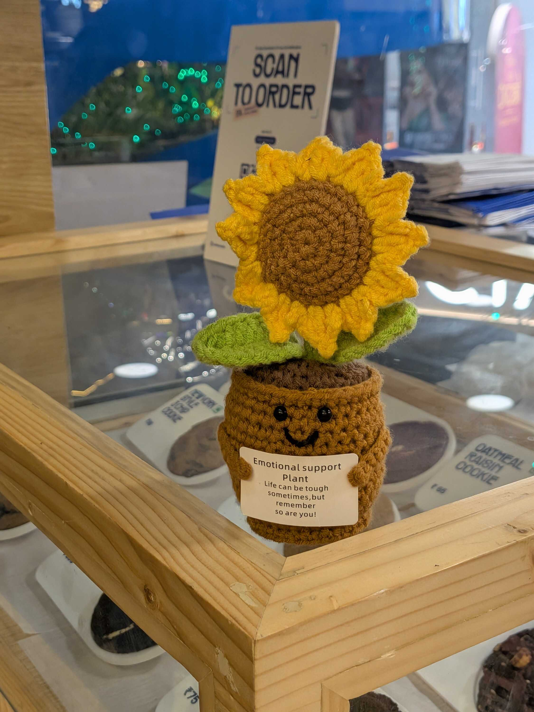
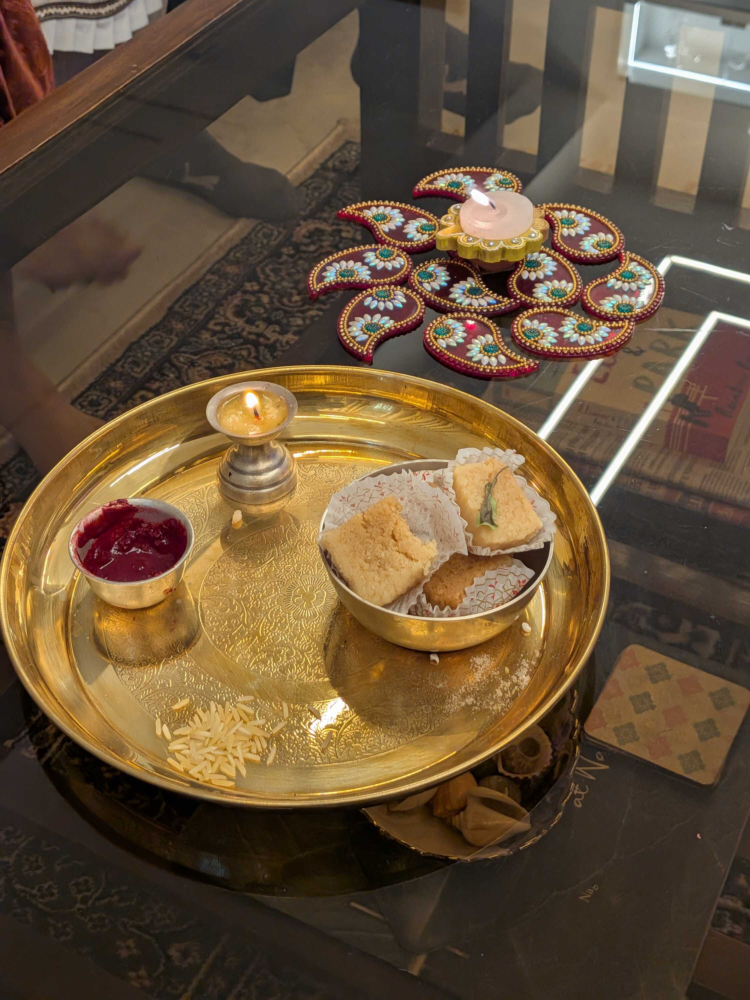

On Saturday, I landed in Delhi and immediately put on my mask and jacket. Booked an Uber while waiting for my luggage. I've noticed that "Uber Prime" in Delhi has a very different standard from an "Uber Prime" in Bengaluru, but not something I'd sit and complain about. I put in my earbuds and settle in for a loong ride.

At home, family had already done most of the cleaning up for Diwali. So on the day, I helped out with setting up _diyas_ and making _rangoli_ patterns in the entryway of the apartment. Our neighbours were making their _rangoli_ at the same time. My mom told my sister and I to take inspiration from what our neighbours were making. The neighbour aunty laughed.

The _pooja_ was followed by having a lot of sweets and spending time with family... before the firecrackers began. After that, there were just explosions that went on past midnight. People setting off bombs to celebrate the festival of lights.

I'm not going to tap into the anger from that day for my own peace of mind. But here's what I left on my Instagram Stories on Diwali.

> "a pigeon has been trying to enter the house because it's scared of the bombs, but it'll be sad to know the sound isn't any less louder inside.
>
> a lot of animals are probably confused right now, because the temperature doesn't feel right for hibernation. but they don't know what AQI or climate change is.
>
> our grandparents will be coughing and wheezing, and our parents will get headaches. your own dogs and cats will be scared as hell.
>
> but hey look at you, you got to play with gunpowder and be a man today! how adorable."

Other posts that capture the sentiment include Ankur's "[May cause respiratory effects](https://ankursethi.com/blog/may-cause-respiratory-effects/)". The explosions didn't falter for the rest of the week -- "Bhaidooj", "Chhat Pooja", "Govardhan Pooja"... there's always excuses for _Sutli Bombs_.

But hey man, you just have to [change the way you think](https://www.digit.in/features/general/how-honeywell-is-quietly-changing-the-way-india-breathes-indoors.html). Breathing is now a growth industry, and [air purifiers are the new water purifiers](https://www.exchange4media.com/out-of-home-news/philips-launches-real-time-dooh-campaign-in-delhi-to-raise-awareness-about-air-quality-101723.html). How dare you think breathing clean air is a universal right?

Later in the week, me and my sister got our ears pierced. Mine was a re-piercing after the last one didn't go well, and she got a second piercing. I tried gaslighting her that the gunshot would hurt but she didn't get baited. I might've already gotten karmic repercussions though, because mine did hurt slightly.

> I was going to add a picture of the piercings but turns out [ears can act as unique identifiers](https://www.abc.net.au/news/2023-07-11/ear-id-international-study-effective-as-fingerprints-dna/102582734)? Human bodies are quite cool.

Rest of the week went by in festivities and consuming of sweets. I usually spend my holidays at home going through old drawers to find anything that's interesting, and this time I found:

- A collection of old software CD's that had really cool designs.
- A photo album of my mother's grandfather, which I digitized for archival.
- An old point-and-shoot that my sister yoinked and will now be using to look cool.
- An old set top box, which I'm thinking of converting into a Linux machine.

To quote myself from the last weeknote, "I’m at home sitting in a familiar chair, watching anime on a familiar TV. Life is good."

With that comfort, I wish you and yours a Happy Diwali from me and mine. Peace and much love.

### Videos I Liked

- "[hi](https://www.youtube.com/watch?v=nYxC9j1Bnrw)" by [bill wurtz](https://www.youtube.com/channel/UCq6aw03lNILzV96UvEAASfQ)
- "[Hermitcraft 11: Episode 31 - i'm scared](https://www.youtube.com/watch?v=Un4uxkiXgIY)" by [Mumbo Jumbo](https://www.youtube.com/@ThatMumboJumbo)
  - **Alternate Title:** "Mumbo Photographs Minecraft Horses"
- "[I Put Apple's HomeView Ad to the Test](https://www.youtube.com/watch?v=yVTcVtLn2o4)" by [Joanna Stern](https://www.youtube.com/@JoannaStern)

### Posts I Loved

- "[Twenty five years of writing on adactio.com](https://adactio.com/journal/22781)" by [Jeremy Keith](https://adactio.com/)
- "[i feel so much shame](https://ifeelsomuchsha.me/)" by [Jackie Liu](https://jackieis.online)
- "[Haubitz+Zoche Frames India’s Iconic Movie Theaters--and Absents Them](https://momus.ca/2021/07/01/haubitzzoche-frames-indias-iconic-movie-theaters-and-absents-them/)" by [Deepa Bhasthi](https://momus.ca/person/deepa-bhasthi/) on [Momus](https://momus.ca/)
- "[How it feels to get an AI email from a friend](https://mrgan.com/blog/how-it-feels-to-get-an-ai-email-from-a-friend/)" by [Neven Mrgan](https://mrgan.com/)
- "[Chain Maintenance](https://sheldonbrown.com/chains.html)" by [Sheldon Brown](https://sheldonbrown.com/)

### Links I Found Cool

Many cool links from [IndieWebClub](https://blr.indiewebclub.org/) this time as well. :)

- [Mazhai](https://mazhai.in/), [Sindhu](https://sindhusp.com/)'s Tamil Poetry Website
- [The Aviation Herald](https://www.avherald.com/)
- The [Wiki Wiki Web](https://wiki.c2.com/)
- The [Web Design Museum](https://www.webdesignmuseum.org/)
- [Ken Rockwell's Photography Website](https://kenrockwell.com/)
- [Zines on India Street Lettering](https://indiastreetlettering.com/zines/)
- "[If This Finds You](https://ifthisfindsyou.app/about)"
